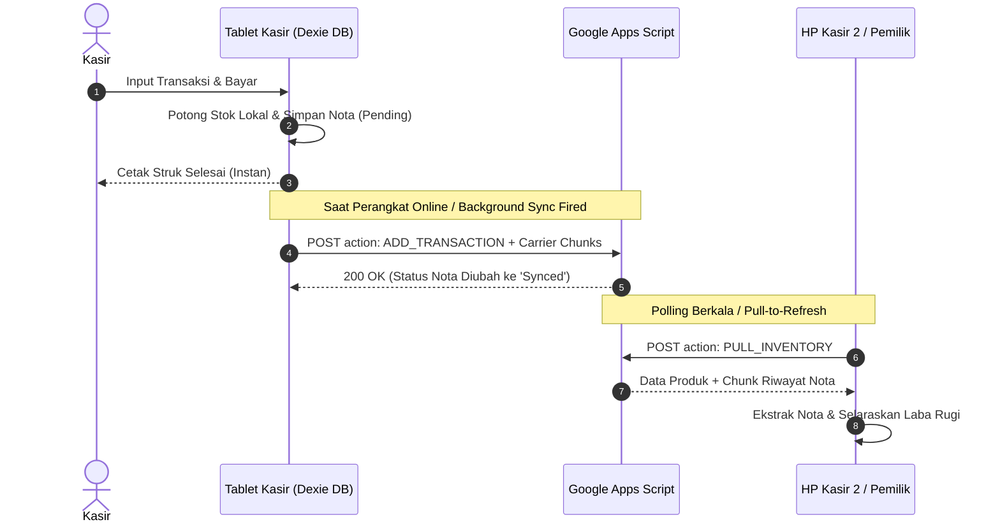

# Arsitektur & Logika Sistem: Toko Trend Kita POS

Dokumen ini membedah arsitektur teknis dan logika rekayasa di balik aplikasi kasir Toko Trend Kita. Sistem ini dirancang dengan prinsip **Zero Server Cost** (tanpa biaya langganan cloud bulanan) dan **Offline-First Resilience** (tetap beroperasi normal saat koneksi internet toko putus atau listrik padam).

---

## 1. Topologi Sistem & Alur Data

Secara konseptual, sistem memisahkan penyimpanan data menjadi dua lapisan:
1. **Local Persistent Storage (Client-Side)**: Berjalan di atas IndexedDB menggunakan wrapper Dexie.js di dalam lingkungan Android WebView (Capacitor).
2. **Cloud Aggregation Layer (Server-Side Tanpa Biaya)**: Berjalan di atas Google Apps Script Webhook yang terhubung langsung ke Google Sheets milik pemilik toko.

```mermaid
graph TD
    subgraph Perangkat Kasir Android (Offline-First)
        UI[Antarmuka Kasir & Pemilik] --> State[Komponen Reaktif & Live Query]
        State --> LocalDB[(Dexie.js IndexedDB)]
        LocalDB --> BT[Printer Thermal Bluetooth / Android Spooler]
    end

    subgraph Sinkronisasi Cloud Hibrida
        LocalDB -->|Antrean Nota Otomatis| SyncBridge[Cloud Sync Bridge]
        SyncBridge -->|Pull / Push Payload| Webhook[Google Apps Script Endpoint]
        Webhook -->|Sheet Records| GSheets[(Google Spreadsheet Master)]
    end

    subgraph Perangkat Lain (Multi-Device)
        GSheets -->|Sinkronisasi Otomatis| HP2[(HP / Tablet Kasir 2)]
        GSheets -->|Pemantauan Realtime| HP_Owner[(HP Pemilik Toko)]
    end
```

---

## 2. Logika Inti: Offline-First & Hybrid Sync Carrier

Tantangan terbesar sistem POS toko kelontong adalah kestabilan koneksi internet. Jika kasir bergantung pada koneksi cloud untuk memproses tiap penjualan, antrean pelanggan akan terhenti begitu jaringan seluler atau WiFi toko mengalami gangguan.

### A. Alur Transaksi Lokal (<50ms)
1. Kasir memilih barang atau memindai barcode.
2. Penjualan langsung disimpan ke tabel `transactions` lokal di IndexedDB dengan status `syncStatus: 'pending'`.
3. Stok barang di tabel `products` langsung dipotong seketika secara atomik menggunakan IndexedDB Transaction (`rw`).
4. Struk dicetak langsung via Bluetooth ESC/POS tanpa menunggu konfirmasi server eksternal.

### B. Mekanisme Sync Carrier (Carrier Payloads)
Google Apps Script tidak memiliki database relasional bawaan seperti PostgreSQL. Untuk menyelaraskan riwayat nota, statistik laba rugi, stok barang, dan status reset antar-banyak perangkat tanpa merusak format spreadsheet akuntansi, dirancang sistem **Sync Carrier**:

- **Baris Carrier Metadata (`__SYS_META__`)**:
  Menyimpan stempel waktu reset terakhir (`lastResetTime`), daftar kode barang yang sudah dihapus (`deletedCodes`), dan timestamp per produk dalam format JSON terkompresi. Baris ini memiliki `stock: 0` dan `costPrice: 0` agar tidak memengaruhi hitungan total aset toko di spreadsheet.
- **Baris Carrier Riwayat Nota (`__TX_CHUNK_*__`)**:
  Mengelompokkan transaksi kasir menjadi paket chunk berisi 15 nota per baris. Setiap HP kasir yang baru dibuka otomatis mengekstrak chunk ini ke dalam database lokalnya, sehingga Riwayat Nota dan Laba Bersih langsung tersinkronisasi 100% tanpa perlu konfigurasi backend rumit.



---

## 3. Logika Cetak Struk: Dual Driver Architecture

Aplikasi mendukung printer kasir thermal ukuran 58mm dan 80mm melalui pendekatan dua lapis:

1. **Direct Web Bluetooth ESC/POS**:
   Mengirimkan byte command mentah langsung ke printer Bluetooth portabel:
   - Inisialisasi printer: `ESC @` (`0x1B, 0x40`)
   - Perataan teks tengah: `ESC a 1` (`0x1B, 0x61, 0x01`)
   - Bobot teks tebal / judul nota: `ESC E 1` (`0x1B, 0x45, 0x01`)
   - Pemotong kertas / Line feed: `GS V 66 0` atau newline feed `LF LF LF`
2. **Android Print Spooler Fallback**:
   Jika browser WebView Android menolak akses Web Bluetooth mentah karena kebijakan permission sistem, aplikasi otomatis mengalihkan alur pencetakan ke Android Print Spooler bawaan OS dengan tata letak struk nota yang dipresisikan khusus agar tidak terpotong.

---

## 4. Partisi Akses (Role Separation & Security)

Untuk mencegah kebocoran data sensitif operasional toko, antarmuka dibagi menjadi 3 tingkat wewenang:
- **Kasir (Karyawan Harian)**:
  Hanya dapat membuka transaksi baru, mencari harga eceran/grosir, memasukkan belanjaan ke keranjang, dan mencetak nota. Kasir dilarang melihat modal barang (HPP) dan total laba harian.
- **Restok Karyawan (Staff PIN: `5678`)**:
  Karyawan kasir dapat menambah kuantitas stok fisik saat kiriman barang dagangan datang tanpa bisa membuka portal pemilik.
- **Portal Pemilik Toko (Owner PIN: `1234`)**:
  Akses penuh ke dashboard finansial, grafik omzet harian/bulanan, perhitungan HPP, laba kotor, laba bersih, manajemen master stok barang, pengaturan identitas toko, serta fitur reset data darurat.

---

## 5. Ringkasan Metrik Pengujian (Quality Assurance Gate)

Kualitas sistem divalidasi melalui 2 lapis pengujian otomatis:
- **Unit Testing (Vitest)**: 39 test case mencakup kalkulasi harga eceran vs grosir partai, perhitungan modal aset, formatting mata uang Rupiah, dan parsing byte printer thermal.
- **End-to-End Testing (Playwright)**: 44 skenario otomatis yang menguji transaksi kasir dari awal, proteksi PIN, pencegahan data zombie saat reset, responsivitas antarmuka mobile/tablet, pemutar video tutorial, hingga simulasi sinkronisasi multi-device (HP 1 mengirim data, HP 2 memvalidasi stok dan riwayat nota secara serentak).
