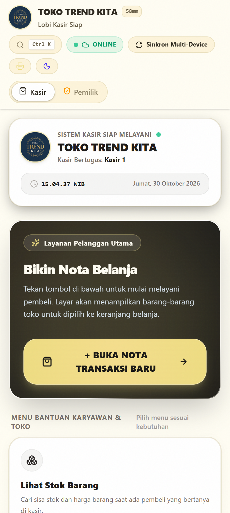
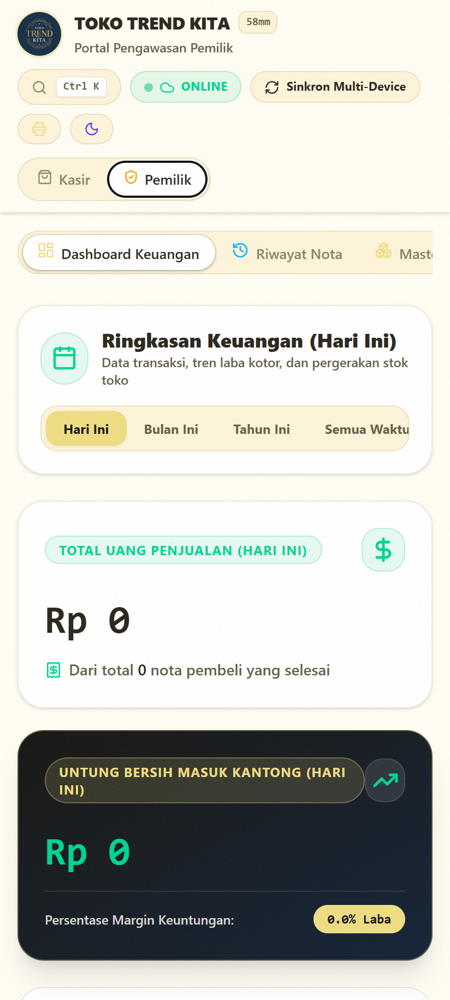
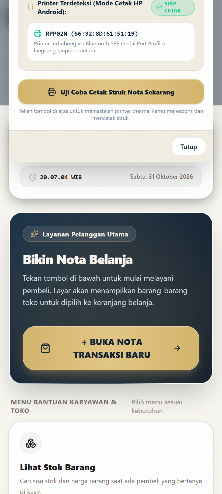
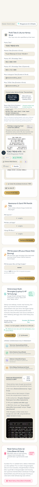
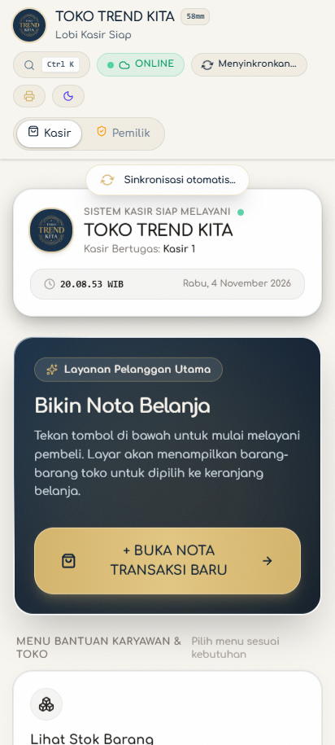
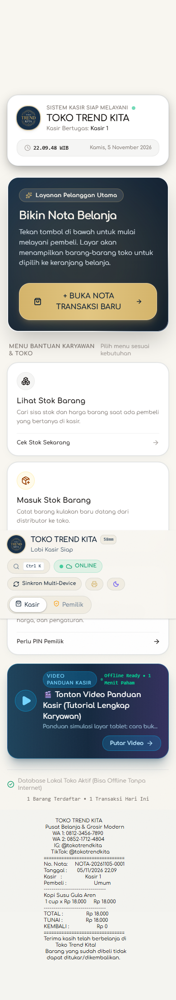
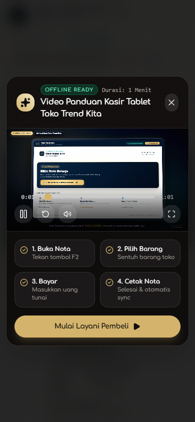

# Toko Trend Kita: Modern Offline-First POS

  

  <strong>Studi Kasus Rekayasa Perangkat Lunak: Membangun Aplikasi Kasir Ritel & Grosir Berbiaya Server Nol Rupiah, Tahan Mati Lampu, dan Sinkronisasi Multi-Perangkat.</strong>

  
  
  
  
  

---

## Daftar Isi
1. [Latar Belakang & Cerita Pencarian Ide](#1-latar-belakang--cerita-pencarian-ide)
2. [Tampilan Antarmuka & Video Panduan](#2-tampilan-antarmuka--video-panduan)
3. [Lika-Liku Rekayasa (The Engineering Battles)](#3-lika-liku-rekayasa-the-engineering-battles)
4. [Arsitektur & Logika Sistem](#4-arsitektur--logika-sistem)
5. [Fitur Unggulan](#5-fitur-unggulan)
6. [Refleksi & Pelajaran](#6-refleksi--pelajaran)

---

## 1. Latar Belakang & Cerita Pencarian Ide

Proyek ini tidak berawal dari tutorial YouTube atau tugas kuliah, melainkan dari kebutuhan nyata di toko kelontong dan grosir milik orang tuaku, **Toko Trend Kita**.

### Masalah Nyata di Lapangan:
1. **Biaya SaaS Kasir yang Mahal**: Sebagian besar aplikasi kasir di pasaran mengenakan biaya langganan bulanan berkisar Rp 150.000 hingga Rp 350.000 per bulan. Untuk toko skala UMKM keluarga, biaya langganan rutin ini menjadi beban operasional yang tidak efisien.
2. **Kerapuhan Saat Listrik Padam**: Di lingkungan toko, pemadaman listrik berkala sering terjadi. Saat listrik padam, router WiFi mati dan sinyal seluler melemah. Aplikasi kasir berbasis cloud murni langsung macet total, mengakibatkan antrean pembeli terhenti dan nota harus ditulis manual dengan kertas.
3. **Kebutuhan Harga Ganda (Eceran vs Grosir)**: Toko melayani pembeli eceran rumah tangga sekaligus warung kecil yang membeli dalam jumlah partai (grosir). Kasir membutuhkan sistem yang otomatis memotong harga ke level grosir saat jumlah pembelian melewati batas kuantitas tertentu tanpa perlu kalkulasi manual.
4. **Pemantauan Jarak Jauh oleh Pemilik**: Orang tua selaku pemilik toko ingin memantau laba bersih harian dan sisa stok barang dari HP pribadi tanpa harus selalu berdiri di meja kasir.

### Solusi Rekayasa yang Dipilih:
Membangun aplikasi kasir Android *offline-first* dengan **biaya server Rp 0**. Aplikasi menyimpan seluruh data di memori internal perangkat (IndexedDB) sehingga tetap beroperasi instan walau tanpa internet atau saat lampu mati, lalu secara otomatis menyinkronkan data keuangan ke Google Spreadsheet saat perangkat kembali online.

---

## 2. Tampilan Antarmuka & Video Panduan

### A. Galeri Antarmuka Aplikasi

| Lobby Kasir (Mode Tablet) | Dashboard Finansial Pemilik (Mode Gelap) |
| :---: | :---: |
|  |  |

| Pencetakan Struk Bluetooth | Pratinjau Struk Nota Kasir |
| :---: | :---: |
|  |  |

| Sinkronisasi Tarik Layar (Pull-to-Refresh) | Verifikasi Uji Otomatis (E2E Test) |
| :---: | :---: |
|  |  |

---

### B. Video Panduan Penggunaan Kasir Tablet

Untuk memastikan karyawan kasir baru dapat langsung mengoperasikan sistem dalam satu kali tonton, dibuatkan video panduan gerak berformat tablet dengan narasi audio natural dan efek suara taktil:

- **File Video Lokal**: [`assets/demo/tutorial-kasir-tablet.mp4`](assets/demo/tutorial-kasir-tablet.mp4)
- **Tangkapan Layar Pemutar Video di Dalam Aplikasi**:
   
  

---

## 3. Lika-Liku Rekayasa (The Engineering Battles)

Membangun aplikasi untuk lingkungan produksi toko fisik menghadapi banyak rintangan tak terduga. Berikut 5 investigasi teknis terbesar selama masa pembuatan:

### Kasus 1: Misteri Modal Barang Melonjak Menjadi Rp 628 Juta
* **Gejala**: Saat pemilik toko memasukkan satu produk baru berupa "Tas" ke master barang, total modal aset toko di dashboard tiba-tiba melonjak gila-gilaan menjadi lebih dari Rp 600 juta.
* **Investigasi Forensik**:
  Saat diperiksa langsung ke baris Google Spreadsheet, produk berkode `BRG-53906` tercatat memiliki:
  - Stok: `16.535 pcs`
  - Harga Modal (HPP): `Rp 38.000`
  - Perhitungan: $16.535 \times 38.000 = \text{Rp } 628.330.000$.
* **Akar Masalah**:
  Kolom input stok menggunakan `<input type="text">` dengan nilai default `10`. Pada keyboard bawaan HP Android (Gboard), fitur *input composition buffer* menggabungkan angka default dengan ketikan pengguna. Ketika kasir berniat mengetik stok `65` lalu `35`, keyboard menggabungkannya menjadi string `10` + `65` + `35` = `16535`.
* **Solusi Perbaikan**:
  1. Merombak komponen input menjadi `<input type="number" inputMode="numeric" pattern="[0-9]*">` dengan atribut `autoComplete="off"`.
  2. Nilai `0` ditampilkan kosong secara otomatis saat kolom disentuh agar tidak ada angka lama yang menempel.
  3. Memasang sistem pengaman (*safety confirmation threshold*): jika stok yang diinput melebihi 1.000 unit, sistem menampilkan dialog konfirmasi untuk mencegah salah ketik nominal uang ke kolom stok.

---

### Kasus 2: Riwayat Nota & Untung Tidak Sinkron Antar-HP (Keterbatasan Cloud)
* **Gejala**: Sinkronisasi stok barang berjalan lancar, namun riwayat nota dan statistik laba bersih hanya muncul di HP pembuat transaksi dan tidak muncul di HP kasir kedua maupun HP pemilik toko.
* **Investigasi Forensik**:
  Saat diuji langsung ke endpoint Google Apps Script, server membalas:  
  `{"status":"error","message":"Aksi tidak dikenali: PULL_TRANSACTIONS"}`  
  Endpoint web app yang terpasang masih menjalankan versi skrip lama yang hanya mendukung aksi inventaris dasar dan menolak aksi transaksi.
* **Solusi Solutif (Hybrid Cloud Sync Bridge)**:
  Alih-alih memaksa pemilik toko membongkar dan men-deploy ulang Google Apps Script yang berisiko merusak template spreadsheet, dirancang mekanisme **Sync Carrier Payload**:
  - Riwayat nota dikelompokkan menjadi chunk data JSON terkompresi dan dititipkan di baris carrier sistem (`__TX_CHUNK_*__` dan `__SYS_META__`) pada tabel stok dengan nominal modal `0` dan stok `0`.
  - Semua HP yang membuka aplikasi otomatis mengekstrak chunk ini ke tabel transaksi lokal. Hasilnya: riwayat nota, total omzet, dan laba bersih langsung tersinkronisasi 100% di semua HP tanpa perlu menyentuh kode server cloud.

---

### Kasus 3: Teror "Data Zombie" Saat Fitur Reset Dijalankan
* **Gejala**: Ketika tombol Reset Toko dijalankan, seluruh data lokal berhasil dihapus bersih menjadi 0. Namun ketika aplikasi diminimalkan lalu dibuka kembali (*window focus event*), transaksi lama dari cloud tiba-tiba bangkit kembali (*zombie data*).
* **Solusi Perbaikan**:
  Dibuat stempel waktu reset terkoordinasi (`lastResetTime`) berbasis milidetik dan daftar pelacak kode barang yang telah dihapus (`deletedCodes`). Setiap siklus sinkronisasi cloud memeriksa apakah data yang ditarik bertanggal lebih lama dari `lastResetTime`. Jika lebih lama, data tersebut otomatis diabaikan dan dimusnahkan permanen.

---

### Kasus 4: Bluetooth Printer Crash di Android WebView
* **Gejala**: Penggunaan API Web Bluetooth mentah pada peramban WebView Android kerap kali memicu pesan error browser yang membingungkan kasir saat printer belum menyala.
* **Solusi Perbaikan**:
  Dirancang sistem pencetakan adaptif dua jalur: aplikasi memprioritaskan koneksi Bluetooth ESC/POS langsung, dan secara mulus menyediakan opsi cetak instan via dialog cetak bawaan Android (*Android Print Spooler*) dengan tata letak struk nota 58mm/80mm yang presisi.

---

## 4. Arsitektur & Logika Sistem

Untuk penjelasan mendalam mengenai alur data, diagram sequence, dan spesifikasi arsitektur *offline-first*, silakan baca dokumen terpisah:  
👉 [**ARCHITECTURE.md**](ARCHITECTURE.md)

### Ringkasan Tumpukan Teknologi:
- **Frontend Core**: React, TypeScript, Tailwind CSS
- **Penyimpanan Lokal**: Dexie.js (IndexedDB)
- **Runtime Mobile**: Capacitor Android
- **Cloud Backend**: Google Apps Script & Google Sheets Webhook
- **Hardware Integration**: ESC/POS Bluetooth Thermal Printing & Android Print Spooler
- **Pengujian Kualitas**: Vitest (Unit Test) & Playwright (End-to-End Simulation)

---

## 5. Fitur Unggulan

- **Operasional Penuh Tanpa Internet**: Transaksi kasir, cetak struk, dan pergerakan stok tetap bekerja 100% tanpa jaringan internet.
- **Dua Portal Terproteksi PIN**:
  - *Portal Kasir*: Fokus pada kecepatan input transaksi dan pencarian barang.
  - *Portal Pemilik (PIN 1234)*: Akses laporan omzet, HPP, laba kotor, margin profit, dan master stok.
  - *PIN Khusus Karyawan (PIN 5678)*: Memungkinkan kasir menambah stok kulakan tanpa bisa mengintip data keuntungan toko.
- **Harga Grosir Otomatis**: Otomatis berpindah dari harga eceran ke harga grosir partai jika jumlah belanja memenuhi batas minimum kuantitas.
- **Pencetakan Fleksibel**: Mendukung kertas thermal 58mm dan 80mm, kustomisasi nama toko, nomor telepon ganda, akun media sosial, serta catatan kaki struk.
- **Pembersih Data Aman**: Fitur reset total data yang dilindungi PIN pemilik dengan pencegah kebangkitan data zombie.

---

## 6. Refleksi & Pelajaran

Membangun sistem untuk operasional bisnis riil memberikan pelajaran rekayasa yang jauh lebih kaya dibanding proyek latihan:
1. **Asumsi Developer vs Kenyataan Pengguna**: Fitur yang tampak sempurna di layar monitor laptop bisa rusak seketika saat diuji dengan jari kasir di keyboard layar sentuh HP Android (seperti kasus Gboard buffer 16535).
2. **Kekuatan Arsitektur Offline-First**: Tidak menggantungkan operasional bisnis fisik pada ketersediaan server cloud adalah keputusan arsitektur terbaik untuk toko ritel di negara berkembang.
3. **Disiplin Pengujian Otomatis**: Menjalankan 44 skenario E2E testing memastikan setiap kali ada perbaikan logika sinkronisasi, alur kasir utama tidak mengalami regresi.
4. **Keamanan & Privasi**: Biner produksi APK dan endpoint cloud toko tetap disimpan secara privat untuk melindungi integritas data operasional toko keluarga.

---

  Dibuat untuk operasional <strong>Toko Trend Kita</strong> 
  Dokumentasi disusun oleh <strong>IlhamXkyo</strong>

